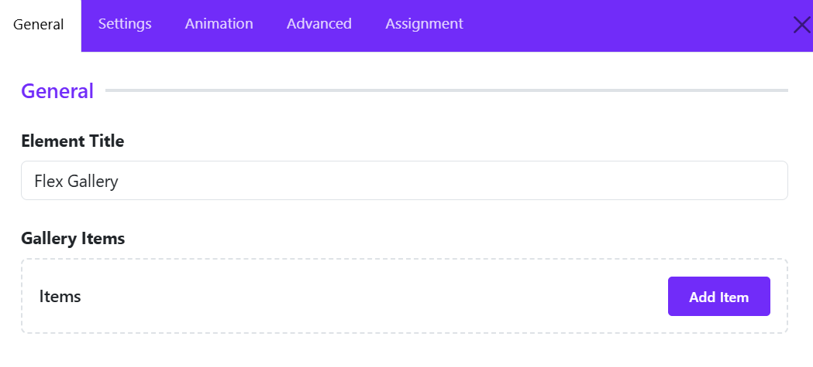
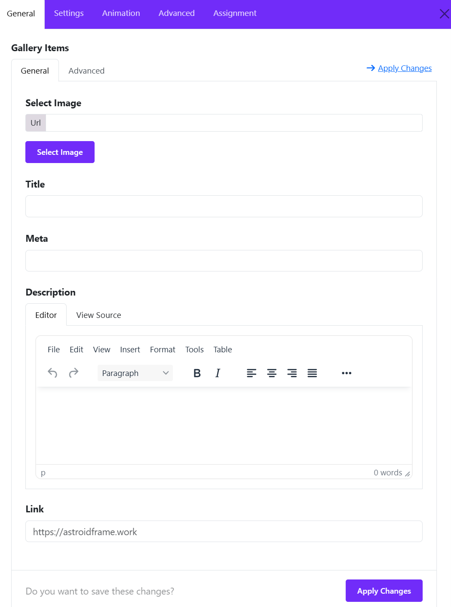
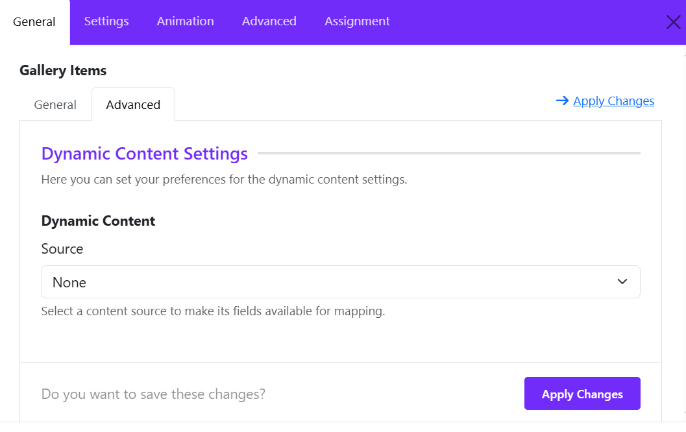
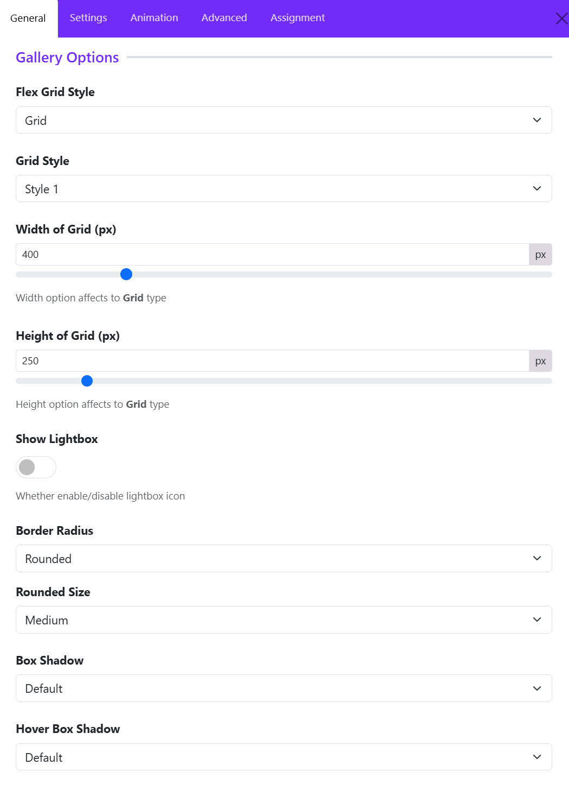
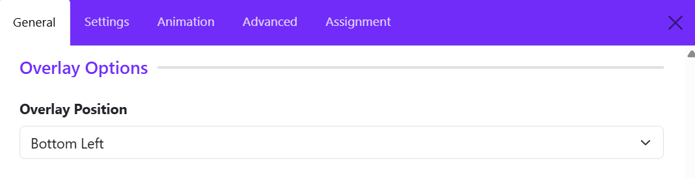
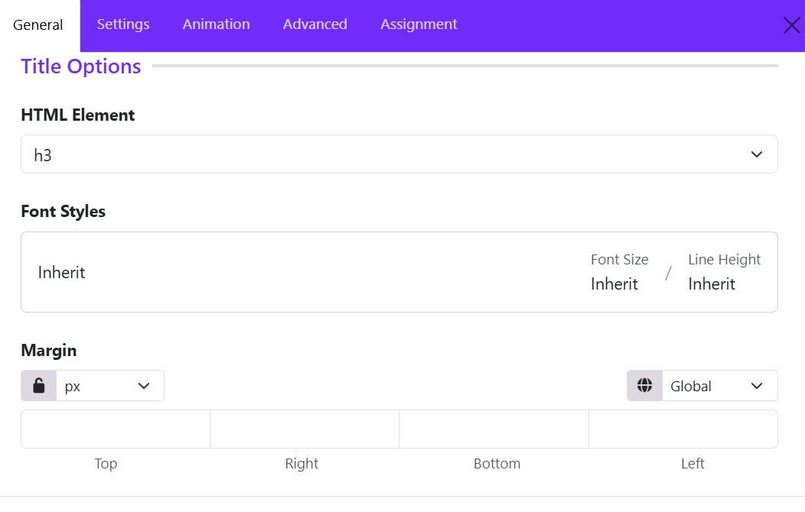
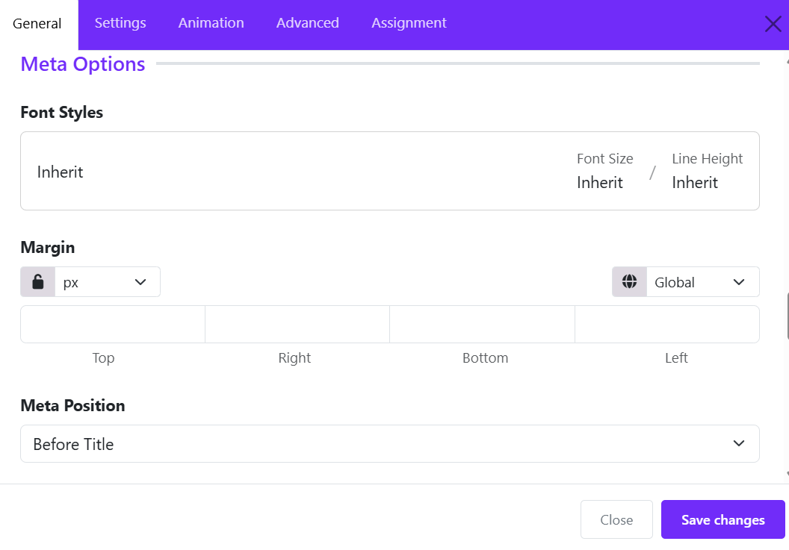
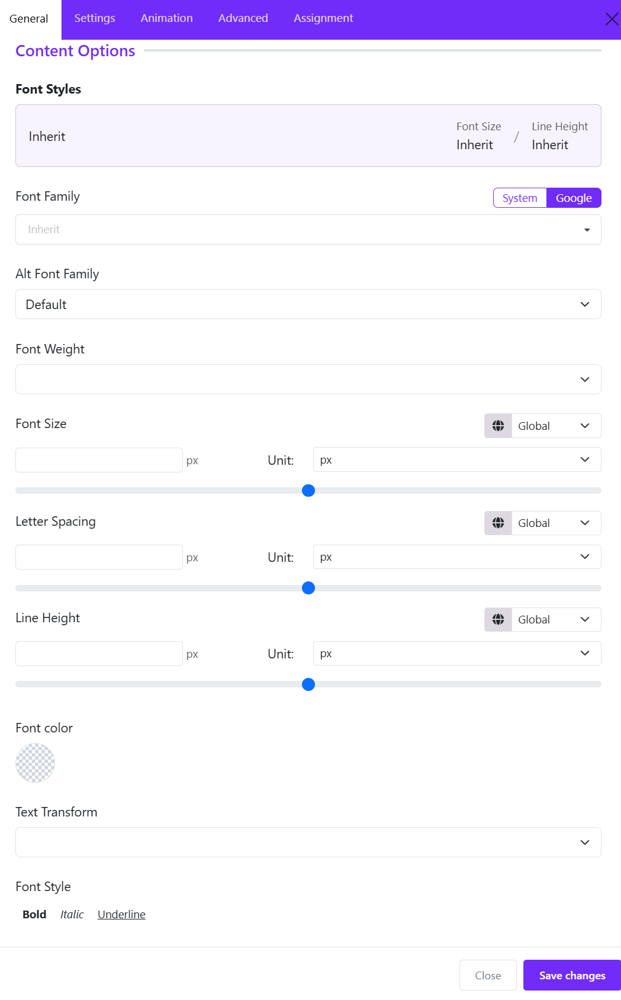
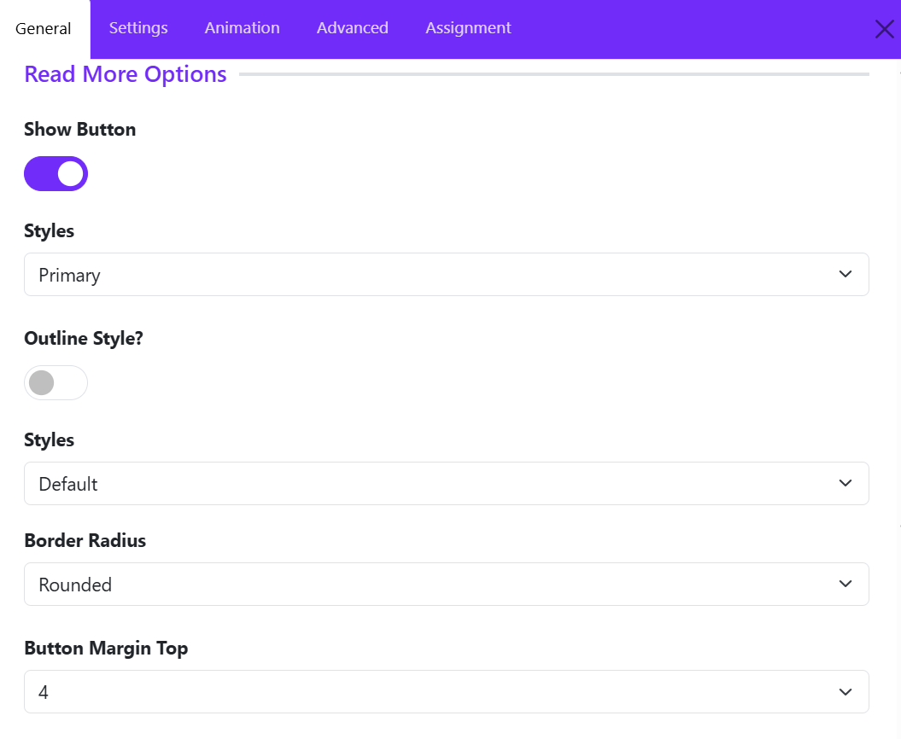

# Flex Gallery

Flex Gallery is a smart, responsive widget that displays your images in a flexible, beautiful grid. It automatically adapts to any device and screen size.

Flex Gallery supports 5 Grid styles, Grid Style 1 through Grid Style 5 along with Vertical Masonry and Horizontal Masonry. It automatically adapts to any device and screen size, with flexible, beautiful layouts.

## How to Add the Widget
- Open your Astroid layout editor.
- Click on **Add Element**.
- Choose **Flex Gallery** from the widget list.

## General Settings

Click on the "Add item" button to add new gallery item.

### Add Gallery Item

#### Select Image

Choose the image to display for the gallery item.

You can use the **Select Image** button to browse and select an image from your media library. The selected image URL will appear in the URL field.

>**Tip:** Use high-quality images with consistent dimensions and aspect ratios to create a visually balanced gallery.

#### Title

Enter a title for the gallery item. This title can identify the image, introduce a project, or highlight the subject of the gallery entry.

**Example:** *Modern Interior Design*, *Our Latest Project*, or *Summer Collection*.

#### Meta

Enter additional information to accompany the gallery item, such as a category, date, location, or short label.

**Example:** *Interior Design*, *Photography*, or *2026 Collection*.

This field is useful for providing context and helping visitors understand the content of each gallery item.

#### Description

Add descriptive content for the gallery item using the built-in rich text editor.

The editor provides formatting tools that allow you to customize the content, including:

- Text formatting, such as bold and italic.
- Paragraph formatting and text alignment.
- Additional content formatting through the editor toolbar.
- HTML editing through the **View Source** tab.

Use the description to provide further details about an image, project, product, or featured item.

#### Link

Enter the URL that visitors should open when clicking the gallery item or its associated link.

You can link to an internal website page, a project detail page, a product page, or an external website.

**Example:** `https://astroidframe.work`

Leave this field empty if the gallery item does not need a destination link.

#### Dynamic Content

Switch to the **Advanced** tab to take advantage of dynamic content to generate gallery from Joomla articles.

#### Applying Changes

After configuring the gallery item, click **Apply Changes** to save your edits and return to the widget configuration.

You can repeat this process to add more items to the Flex Gallery. For each item, configure its image, title, metadata, description, and link as needed.

**Tip:** For the best results, use descriptive titles, concise metadata, and relevant images to keep your gallery consistent and engaging.

## Gallery Options

Configure the layout and appearance of the Flex Gallery using the following options.

#### Flex Grid Style

Select the layout type for displaying gallery items.

- **Grid**: Arranges gallery items in a structured grid with consistent item dimensions.
- **Vertical Masonry**: Arranges gallery items in columns, allowing items to have different heights while maintaining a masonry layout.
- **Horizontal Masonry**: Arranges gallery items in rows, allowing items to have different widths while maintaining a masonry layout.

#### Grid Style

If you choose Grid style, here you can select a predefined style for the grid layout. There are 5 styles available: Style 1, Style 2, Style 3, Style 4, and Style 5.

#### Width of Grid (px)

Set the width of each grid item in pixels. This option applies to the Grid layout type.

#### Height of Grid (px)

Set the height of each grid item in pixels. This option applies to the Grid layout type.

#### Show Lightbox

Enable or disable the lightbox icon for gallery images.

#### Border Radius

Set the corner style of gallery items.

#### Rounded Size

Set the corner radius size when **Border Radius** is set to **Rounded**.

#### Box Shadow

Set the shadow effect applied to gallery items.

#### Hover Box Shadow

Set the shadow effect applied to gallery items on hover.

## Overlay Options

The Overlay Options section allows you to configure the position of the overlay displayed on gallery items. This setting determines where the overlay content appears within each image, helping you create a consistent and visually appealing gallery layout.

**Overlay Position** option controls the placement of the overlay within each gallery item. Available options determine which area of the image displays the overlay, such as:

- Top Left – Positions the overlay in the top-left corner.
- Top Center – Positions the overlay at the top center.
- Top Right – Positions the overlay in the top-right corner.
- Center Left – Positions the overlay along the left side, vertically centered.
- Center – Positions the overlay at the center of the image.
- Center Right – Positions the overlay along the right side, vertically centered.
- Bottom Left – Positions the overlay in the bottom-left corner.
- Bottom Center – Positions the overlay at the bottom center.
- Bottom Right – Positions the overlay in the bottom-right corner.

> Example

Select Bottom Left to display the overlay content in the lower-left corner of each gallery image.

## Title Options

The Title Options section allows you to customize the HTML heading level, typography, and spacing of titles displayed in the Flex Gallery widget. These settings help you maintain a clear content hierarchy and ensure consistent styling across gallery items.

### HTML Element

The HTML Element option determines the HTML heading tag used for the gallery title. Select the appropriate heading level, such as H1, H2, H3, H4, H5, or H6, according to your page structure.

Example: Choose h3 to display gallery titles as third-level headings.

>Tip: Use heading levels in a logical order to maintain a clear document structure and improve accessibility and SEO.

### Font Styles

The Font Styles option controls the typography of gallery titles.

- Font Family: Choose the font used for the title. Select Inherit to use the inherited font settings.

- Font Size: Set the title's font size or use Inherit to follow the existing typography settings.

- Line Height: Adjust the vertical spacing between lines of title text. Use Inherit to follow the inherited line-height setting.

These options help you match gallery titles to your website's typography and design.

### Margin

The Margin option controls the external spacing around the gallery title. Configure the margin independently for each side:

- Top: Adds space above the title.

- Right: Adds space to the right of the title.

- Bottom: Adds space below the title.

- Left: Adds space to the left of the title.

**Additional Controls**

- Unit: Select the measurement unit, such as pixels (px), for the margin values.

- Lock/Unlock: Lock the values to apply the same margin to all four sides, or unlock them to configure each side independently.

- Global: Use the available global or responsive settings controls to manage how the margin values are applied.

## Meta Options

The Meta Options panel controls the typography, spacing, and placement of supplementary information (meta text) displayed with gallery items.

### Font styles

Customize the typography of the metadata text: Font family, Font size, line height, letter spacing, ...)

### Margin

Controls the space outside the metadata element, helping you adjust the distance between the metadata, title, and surrounding content.

### Meta Position

Determines where metadata appears in relation to the gallery item's title.

- Before Title: Useful for categories, labels, or short introductory information.
- After Title: Useful for dates, author names, or supporting details, if supported by the widget.

## Content Options

### Typography & Font Settings

- System / Google Toggle: Choose whether to load standard System fonts or web fonts from Google.   
- Font Family: Dropdown menu to select the primary font face applied to the widget content.   
- Alt Font Family: Select an alternative/fallback font family to be used if the main font fails to load.   
- Font Weight: Controls the thickness or boldness level of the font (e.g., Light, Regular, Semi-Bold, Bold).

### Sizing & Spacing Controls

Each spacing control features a responsive breakpoint switcher (default: Global) to apply different values across desktop, tablet, or mobile views.   
- Font Size: Set the font size using the manual input box, slider, or Unit dropdown (e.g., px, em, rem).   
- Letter Spacing: Adjust the space between individual text characters via input field, slider, or unit selector.   
- Line Height: Modify the vertical distance between lines of text using the numeric input, slider, or unit dropdown. 

### Color & Styling Options

- Font Color: Click the color swatch circle to open the color picker and assign a custom text color.   
- Text Transform: Dropdown selector to modify text casing (e.g., Uppercase, Lowercase, Capitalize).   
- Font Style: Toggle text formatting options: Bold, Italic, Underline.

## Read More Options

These settings control whether a Read More button appears on gallery items and how the button looks.

### Show Button

Purpose: Enables or disables the Read More button.
- ON (purple): The button can appear for gallery items that have the necessary link or destination configured.
- OFF (gray): The button is hidden.

> **Recommendation**: Enable this option if you want visitors to open a gallery item's detail page or visit its linked destination.
Note that enabling the button alone may not be enough. Each gallery item may also need a URL and link text configured in its content settings.

### Styles

This option determines the button's visual theme, such as its background and text colors, according to the active template's styling. You can choose a style from the dropdown list: 

- Primary:	Main call-to-action; usually uses the theme's primary color.
- Secondary:	A less prominent alternative button.
- Success:	Positive actions or completed items.
- Danger:	Destructive or warning-related actions.
- Warning:	Actions requiring attention.
- Info:	Informational actions.
- Light:	Light-colored button.
- Dark:	Dark-colored button.
- Link:	Button styled like a text link.

> **Recommendation**: Use Primary for a prominent Read More button. Use Secondary or Link when you want the gallery images and titles to receive more visual attention.

### Outline Style

Purpose: Changes the button from a filled style to an outlined style.
- OFF: Displays the normal filled button style.
- ON: Typically displays a transparent or unfilled button with a colored border and text.

For example:
- Normal style: purple background with white text.
- Outline style: transparent background with a purple border and purple text. 
  
> **Recommendation**: Keep Outline Style OFF for a prominent call to action. Turn it ON for a lighter appearance that blends into a minimalist gallery design.

### Style 

This option allows you to choose a button size: 

- Default: Uses the default button size defined by the framework or template.
- Large: Creates a larger button with more visual emphasis.
- Small: Creates a more compact button.

> **Recommendation**: Use Default for most gallery layouts. Choose Small for dense grids with several columns, or Large when the button is an important call to action

### Border Radius

This setting controls the shape of the button's corners. (Round, Square, Pill or Circle)

> Recommendation: Use Rounded for a modern, balanced appearance. Use Square if your website uses sharp edges throughout its design.

### Button Margin Top

Adds space above the Read More button, separating it from the description or other content above it.

Increasing the margin creates more vertical separation; decreasing it brings the button closer to the description.

